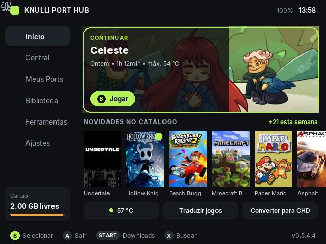
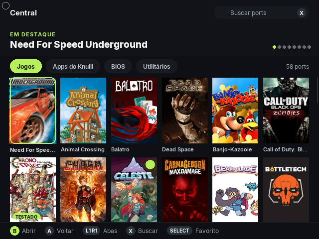
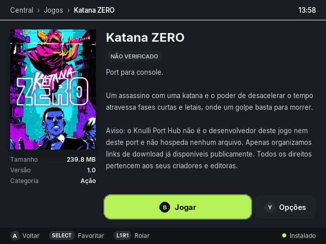
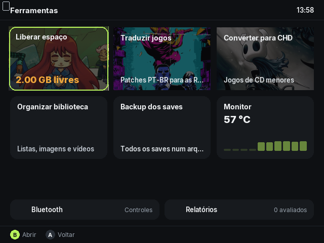
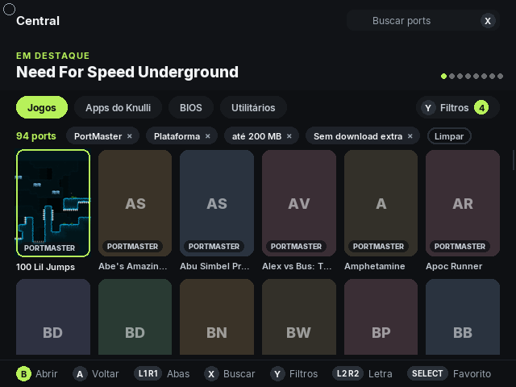
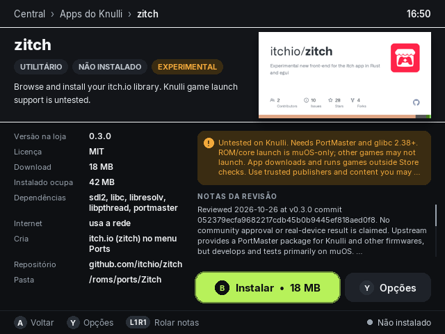

<p align="center">
  
</p>

<h1 align="center">Knulli Port Hub</h1>

<p align="center">
  <b>Central de ports, apps, ferramentas e temas para consoles com Knulli</b><br>
  Feito com base no <a href="https://github.com/liralflsti-wq/r36s-port-hub">R36S PORT HUB</a>, de <b>Lag do Lira</b>.
</p>

<p align="center">
  <a href="../../releases/latest"><b>Baixar a versão mais nova</b></a> ·
  PT-BR / EN / RU ·
  testado no Anbernic RG35XXH (Knulli Scarab)
</p>

---

<p align="center">
  
  
</p>
<p align="center">
  
  
</p>
<p align="center"><sub>Telas do tema Knulli Premium (640×480), geradas pelo próprio app em modo de teste.</sub></p>

## O que é

O app do R36S PORT HUB (LÖVE 11.5) adaptado para o **Knulli** (base Batocera) e testado no **Anbernic RG35XXH** (Allwinner H700, 640×480). Instala ports, apps e ferramentas sem computador, cuida da biblioteca de jogos e traz ajustes do sistema num lugar só.

Tudo o que é do Knulli só vale quando o app detecta o Knulli; no R36S/dArkOS o comportamento é o original.

## Recursos

### Ports (Central › Jogos)
- **Catálogo do R36S PORT HUB** + **catálogo extra do Knulli** (`knulli-catalog.json`) com a situação de cada port no RG35XXH: *testado*, *pesado* ou *não funciona*, com notas. O app avisa antes de baixar um port pesado.
- **Catálogo oficial do PortMaster** na mesma lista: só ports prontos para rodar, completos (sem pedir arquivos do jogo), para aarch64 e compatíveis com o Knulli. Os runtimes que faltam são baixados junto. Ports do PortMaster ficam **sempre por último**; os do autor vêm primeiro.
- Instala em `/userdata/roms/ports`, esconde os scripts internos dos ports na lista do EmulationStation e recarrega a lista ao sair (API do EmulationStation, sem reiniciar).
- **Busca instantânea** (tolera erros de digitação, guarda o histórico) e **painel de filtros**: origem, categoria, situação no RG35XXH, tamanho, runtime e ordenação; L2/R2 pulam por letra.
- Página de cada port com capa, arte de fundo, ficha, aviso de compatibilidade, instalar / jogar / atualizar / remover, favoritos e novidades do catálogo.

<p align="center"> </p>

### Apps do Knulli (Central › Apps do Knulli)
- A **Knulli App Store** integrada: lista oficial (assinada) de apps da comunidade, com página de detalhes, aviso, notas da revisão e **instalar, atualizar, reparar e remover**. Não precisa instalar a loja em Ports: o hub mantém a própria cópia do instalador e da lista (release oficial, conferida por sha256) e procura versão nova a cada 12 h.
- **Apps do hub** (lista `apps` do catálogo extra): apps que não são ports e ganham um atalho no menu **Tools**. O primeiro é o **Tubo**.

### Tubo — cliente leve de YouTube


Cliente **não oficial** de YouTube para uso pessoal, feito para o RG35XXH: busca, canais, inscrições locais, histórico, assistir mais tarde e modo só áudio, vídeo até 480p. Interface em pygame, vídeo no **mpv**, dados do YouTube pelo **yt-dlp** (baixado da release oficial na instalação e atualizado pelo próprio Tubo). Não tem ligação com o YouTube ou o Google; inscrições e histórico ficam só no console.

Instale em **Central › Apps do Knulli › Tubo (YouTube)**. Vai para `/userdata/system/knulli-tools/tubo` e aparece no menu **Tools**. O código fica em [`apps/tubo`](apps/tubo); cada versão é publicada sozinha como Release `tubo-v*`.
<br clear="right">

### Pacote de músicas de games (Utilitários)
32 remixes do **[OverClocked ReMix](https://ocremix.org)** (Mario, Zelda, Sonic, Castlevania, Chrono Trigger, Mega Man...) para tocar no menu do Knulli. O repositório guarda **só o índice** ([`knulli-music.json`](knulli-music.json)): cada console baixa as faixas dos espelhos oficiais do OC ReMix, uma por vez, confere com `ffprobe`, converte para OGG Vorbis 96 kbps e põe em `/userdata/music/ocremix` (cerca de 88 MB), com `CREDITOS.txt`. Dá para escolher **só as do pacote** ou **junto com as músicas do Knulli**. **Remover** apaga só o que o pacote instalou. Os créditos de cada faixa (jogo, remix, artistas, página no OC ReMix) aparecem no app.

### Traduzir jogos (PT-BR)
- Procura patches de tradução para as suas ROMs (índice [`knulli-translations.json`](knulli-translations.json), mais de 790 traduções de grupos brasileiros: PO.B.R.E, tradutores no GitHub, RHDN) e aplica numa cópia, com **desfazer**.
- **Cartucho** (SNES, GBA, Mega Drive, NES, Master System, N64, GB/GBC, Game Gear, PC Engine, NDS) e **CD** (PS1, Sega CD, PC Engine CD, Saturn, Dreamcast; em .cue/.bin, .iso ou direto no .chd).

### Converter para CHD
Diminui jogos de CD (PS1, Sega CD, PC Engine CD, Saturn, Dreamcast...) com o `chdman`, que o hub baixa e instala sozinho. Confere o resultado antes de apagar o original.

### Ferramentas do Knulli
- **Biblioteca: manutenção** — faxina das listas de jogos, imagens automáticas (libretro-thumbnails), `.m3u` para jogos de vários discos, limpeza e redução de vídeos de prévia.
- **Gerenciador de espaço do cartão** — maiores jogos × vezes jogado; apaga ROMs sem perder os saves.
- **Backup completo dos saves** — saves de todos os sistemas e ports num arquivo (`/userdata/backups/knulli-port-hub`).
- **Monitor do console** — temperatura, CPU, RAM e bateria ao vivo.
- **Controle Bluetooth** — procurar, parear e conectar controles.
- **Modo desempenho por port** — CPU/GPU no máximo, EmulationStation pausado, temperatura e tempo medidos; depois de jogar, **"Como rodou?"** gera **relatórios de compatibilidade** que podem ir para o catálogo extra. "Sempre em modo desempenho" vale também ao abrir pelo menu do Knulli.
- **Memória extra (zram)** — liga/desliga o zram do Knulli, mostra RAM livre, tamanho e uso; avisa antes de abrir port pesado ou que já fechou por falta de memória.
- **Traduções aplicadas** — cada jogo traduzido pelo app com o backup da ROM original: recuperar a original, marcar como testado, excluir o backup (um ou todos os testados) e o espaço que os backups ocupam.
- Do original: analisador e verificador do cartão SD, verificador de integridade dos ports, diagnóstico de rede e teste de velocidade, BIOS (download, verificação e instalação em `/userdata/bios`), teste de analógicos e botões, FTP, transmissão da tela pelo navegador e gravação de vídeo.

### Sistema
- **Wi-Fi** (connman/`knulli-wifi`), **data, hora e fuso** (`knulli-timezone`, `ntpd`), **brilho, LED, áudio, temperatura de cor**, bateria, desligar/reiniciar (`knulli-shutdown`).
- **Temas do hub**: **Knulli Premium** (padrão: escuro, barra lateral, capas e artes do Steam), Padrão, Pastel Pop, Neon Grid e Wii Blue.
- **Loja de Temas do EmulationStation** (`/userdata/themes` + `ThemeSet`), com prévia e compatibilidade.
- **Atualização automática**: cada mudança no código vira uma Release neste repositório; o app mostra **"Nova versão disponível"** e atualiza pelo Wi-Fi (SELECT na tela inicial). Os catálogos (ports, traduções, músicas, apps) atualizam sozinhos, sem nova versão.
- **Idiomas**: português (Brasil), inglês e russo.

### Botões do RG35XXH
O SDL do Knulli usa as posições do controle de Xbox. Como no EmulationStation: **B (baixo) confirma, A (direita) volta**, X e Y trocados do mesmo jeito. Ícones e textos do app já mostram as letras certas.

## Instalação

1. Baixe `Knulli-Port-Hub.zip` em **[Releases](../../releases/latest)**.
2. Extraia na pasta `ports` do cartão (`/userdata/roms/ports`):
   ```
   /userdata/roms/ports/Knulli Port Hub.sh
   /userdata/roms/ports/r36sporthub/
   ```
3. Atualize a lista de jogos (menu do EmulationStation) e abra **Knulli Port Hub** em **Ports**.

**Requisitos:** Knulli com o PortMaster (já vem no sistema) e o runtime `love_11.5`. Wi-Fi para baixar ports, apps e catálogos.

Depois de instalado, o próprio app avisa e instala as versões novas.

## Para quem mantém o catálogo

| Arquivo | O que é |
|---|---|
| [`knulli-catalog.json`](knulli-catalog.json) | Situação dos ports no RG35XXH (`h700`), ports a mais (`download_url`) e apps do hub (`apps`) |
| [`knulli-translations.json`](knulli-translations.json) | Índice de traduções PT-BR (patches e onde baixar) |
| [`knulli-music.json`](knulli-music.json) | Índice do pacote de músicas (sem áudio: links dos espelhos oficiais do OC ReMix) |

```json
{ "ports": [
  { "id": "<id do catálogo oficial>",
    "h700": { "status": "testado | pesado | nao_funciona", "note": "texto", "tested_on": "RG35XXH / Knulli" } }
] }
```

Itens com `download_url` e um `id` novo entram como ports normais (mesmo formato do catálogo oficial, veja [`docs/CATALOGO.md`](docs/CATALOGO.md)). Mudanças só nesses arquivos não geram versão nova do app.

`"hidden": true` num item com o `id` do catálogo oficial **esconde o port no Knulli** (ex.: `ducktales-remastered`, que não abre em nenhum aparelho com o APK do pacote).

#### Downloads quebrados (`hidden` x `broken`)

- `"hidden": true` = **permanente**: o port some no Knulli até alguém tirar o campo (ex.: `ducktales-remastered`).
- `"broken": {...}` = **download quebrado conhecido**: o port fica escondido, mas o app de cada pessoa reverifica o link (1 vez por dia, só 1 KB com `Range`, sem baixar o jogo) e o traz de volta sozinho quando voltar a funcionar. Também volta se a `download_url` do port mudar no catálogo oficial.

```json
{ "id": "super-mario-strikers",
  "broken": { "reason": "link | package", "url": "<url que falhou>", "since": "2026-11-25",
              "http": 403, "code": "no_script", "size": 888549548, "etag": "\"…\"", "last_modified": "…", "note": "texto" } }
```

| `reason` | Quando usar | Volta quando |
|---|---|---|
| `link` | HTTP 403/404/410 ou página HTML no lugar do arquivo | o link responde 200/206 com algo que não é HTML (assinatura ZIP/RAR/7z/gzip/xz/bz2/tar ou Content-Type de arquivo) |
| `package` | não é ZIP/RAR/7z/TAR, ou não tem `.sh` na raiz depois de extrair | o arquivo do servidor **mudou**: tamanho diferente de `size` (sem tamanho, `etag` ou `last_modified` diferentes) |

O app também marca sozinho, no aparelho de cada pessoa, quando um download do catálogo falha por esses motivos (falha de rede do próprio aparelho — sem internet, timeout, DNS — nunca marca). Configurações › Downloads › **Itens escondidos** mostra o motivo, a última verificação, **Verificar agora** e **Reativar**; **Mostrar itens com download quebrado** volta a exibir todos. Quando um item volta, a Central avisa "X voltou a ficar disponível".

#### Perfis recomendados (`h700.tune`)

Quem baixa um port com perfil já recebe o jogo ajustado para o RG35XXH. Na instalação/atualização pelo hub o app pergunta uma vez ("Aplicar ajustes recomendados para o RG35XXH?") e depois aplica sozinho (Configurações › Ajustes recomendados). Na página do port, o cartão **Ajustes para o RG35XXH** mostra o que o perfil faz, se está aplicado, e tem **Aplicar** / **Desfazer** (também para ports já instalados).

```json
{ "id": "scott-pilgrim-ex",
  "h700": { "status": "pesado", "note": "…",
    "tune": { "perf": true, "zram": true, "cpu_max": true,
      "note": "Sem a memória extra (zram) fecha por falta de memória.",
      "settings": [ { "file": "savedata/Settings.cfg", "format": "json",
        "set": { "ResolutionScale": 0.75 }, "default": { "ResolutionScale": 1.0 },
        "only_if_missing_or_default": true } ] } } }
```

| Campo | O que faz |
|---|---|
| `perf` | "Sempre em modo desempenho": CPU no governador `performance` e no teto de fábrica, GPU a 696 MHz, EmulationStation pausado. Vale também ao abrir pelo menu do Knulli (o hub põe um bloco guardado logo depois do shebang do `<Port>.sh`, marcado por `PORTHUB_PERF_WRAP`; desmarcar tira o bloco). |
| `zram` | Liga a memória extra (zram) do Knulli, de forma permanente. |
| `cpu_max` | Informativo: o modo desempenho já põe a CPU no teto de fábrica (`cpuinfo_max_freq`, 1704 MHz no H700, sem overclock). |
| `note` | Texto curto mostrado no app. |
| `settings` | Lista de ajustes em arquivos de configuração **do próprio port** (caminho relativo à pasta dele; nada fora dela). `format`: `json` ou `ini` (`section` opcional). Só o valor das chaves em `set` muda; o resto do arquivo fica igual. Com `only_if_missing_or_default` (padrão), só muda se a chave não existe ou ainda está no valor de `default` (o usuário não mexeu). Cópia do arquivo antes em `r36sporthub/conf/tune-backup/<id>/`. Arquivo que o jogo ainda não criou fica pendente. |

**Desfazer** tira o "sempre em modo desempenho" (se foi o perfil que ligou) e volta os valores que o perfil mudou, se o usuário não mudou depois. A memória extra continua ligada.

### Gerar o pacote

Cada push em `src/`, `port/` ou `tools/` publica uma Release sozinho (`.github/workflows/release.yml`). Para montar à mão (Linux ou no próprio console, com `zip` e `python3`):

```sh
tools/build_knulli.sh      # -> build/Knulli-Port-Hub.zip
```

O Tubo tem o próprio fluxo (`.github/workflows/tubo.yml`): ao subir `VERSION` em `apps/tubo/app/tubo.py`, sai a Release `tubo-v<versão>` e o catálogo é atualizado com o link e o sha256.

## Créditos e licença

- **R36S PORT HUB:** © 2026 **Lag do Lira** ([YouTube](https://www.youtube.com/@LagdoLira)). Este projeto foi feito com base no [R36S PORT HUB](https://github.com/liralflsti-wq/r36s-port-hub) (repositório original). Licença própria (veja [LICENSE](LICENSE)). Documentação original: [README-R36S-PORT-HUB.md](README-R36S-PORT-HUB.md).
- **Knulli** e **Knulli App Store** (jellydn/knulli-app-store) e seus autores; **PortMaster** e os porters de cada port.
- **Músicas:** [OverClocked ReMix](https://ocremix.org) e os artistas de cada arranjo (lista completa no app e em `knulli-music.json`). As composições originais pertencem aos seus donos. Nenhum arquivo de áudio é hospedado aqui.
- **Traduções PT-BR:** PO.B.R.E, Romhacking.net e os grupos e tradutores de cada patch.
- **Tubo:** [yt-dlp](https://github.com/yt-dlp/yt-dlp) (Unlicense), [mpv](https://mpv.io) (GPL/LGPL), pygame (LGPL).
- **Fonte Inter** (SIL Open Font License), **libretro-thumbnails**, artes do Steam para capas e fundos, `chdman` (MAME).
- Jogos, ports, BIOS, músicas e demais arquivos de terceiros pertencem aos seus autores e não fazem parte deste repositório.
